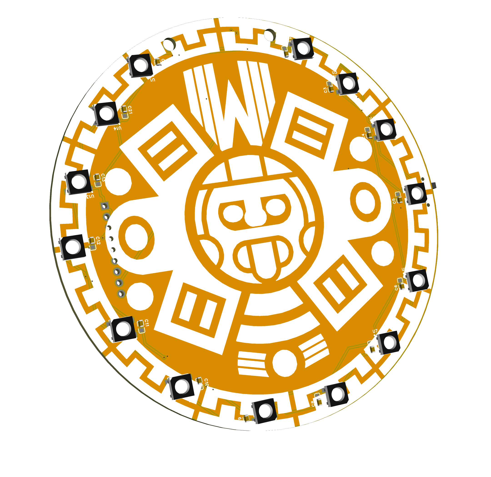

# Hardware — Badge AHAU CTF 2026

Diseño electrónico abierto del badge: proyecto de EasyEDA Pro, lista de materiales y archivos de fabricación.

## Contenido

| Archivo | Descripción |
|---|---|
| `AHAU_CTF26_BAdge.epro` | **Proyecto fuente de EasyEDA Pro** (esquemático + PCB + símbolos + footprints). Ábrelo en [EasyEDA Pro](https://easyeda.com/) para editar. |
| `SCH_Badge_AHAU_CTF_2026.pdf` | Esquemático en PDF, legible sin EasyEDA. |
| `BOM_AHAU_CTF_Badge_2026.xlsx` | Lista de materiales (Bill of Materials) en Excel. |
| `BOM_AHAU_CTF_Badge_2026.csv` | Misma BOM en formato abierto CSV. |
| `Gerber_AHAU_CTF.zip` | Archivos de fabricación (Gerbers + taladros) listos para el PCB house. |
| `3D_Badge_AHAU_CTF_2026.step` | Modelo 3D del PCB (STEP) para CAD / carcasas. |

## Cómo abrir el proyecto

1. Crea una cuenta en [EasyEDA](https://easyeda.com/) y abre **EasyEDA Pro**.
2. `Archivo → Abrir → Proyecto` y selecciona `AHAU_CTF26_BAdge.epro`.
3. Desde ahí puedes ver/editar el esquemático y el PCB, y re-exportar Gerbers o BOM.

## Cómo fabricar la placa

1. Sube `Gerber_AHAU_CTF.zip` a tu fabricante (JLCPCB, PCBWay, etc.).
2. Usa `BOM_AHAU_CTF_Badge_2026.csv` para pedir los componentes (incluye números de parte **LCSC**).
3. Si pides ensamblado (PCBA), necesitarás además el archivo **Pick & Place / CPL**, que puedes exportar desde EasyEDA.

## Lista de materiales (resumen)

| Cant. | Componente | Designadores | Parte LCSC |
|---:|---|---|---|
| 1 | ESP32-S3 SuperMini | U16 | — |
| 14 | LED RGB WS2812B-B | U1–U14 | C52941391 |
| 14 | Capacitor 1 µF 0603 | C1–C13, C21 | C15849 |
| 1 | Capacitor 1000 µF 25 V | C14 | C2166241 |
| 2 | Botón táctil (MODO / ACCIÓN) | SW2, SW3 | C49234130 |
| 1 | Switch deslizante SPDT (encendido) | SW1 | C49023767 |
| 1 | Conector PH2.0 2P (batería) | CN1 | C52037422 |
| 1 | Header 9P 2.54 mm | U15 | — |
| 2 | Barreno M3 | SCREW1, SCREW2 | — |

> La BOM completa (fabricante, datasheet, descripción) está en los archivos `.xlsx` / `.csv`.

## Conexiones con el firmware

Los pines coinciden con el firmware en [`../Software/wifi_monitor/wifi_monitor.ino`](../Software/wifi_monitor/wifi_monitor.ino):

| Función | GPIO |
|---|---|
| Tira de 14 LEDs WS2812B | `GPIO1` |
| LED RGB de estado | `GPIO48` |
| Botón MODO | `GPIO8` |
| Botón ACCIÓN | `GPIO9` |
